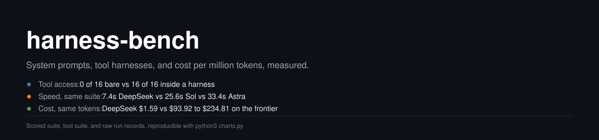
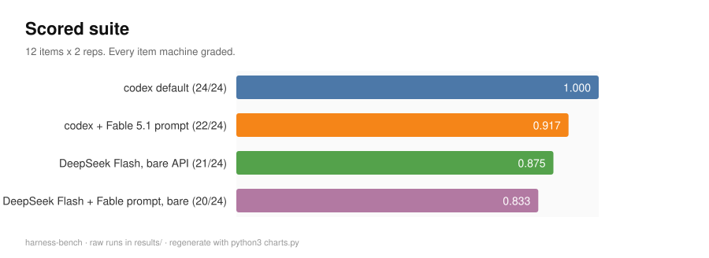
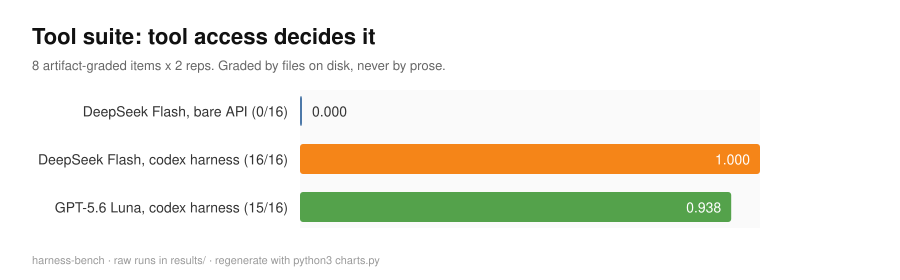
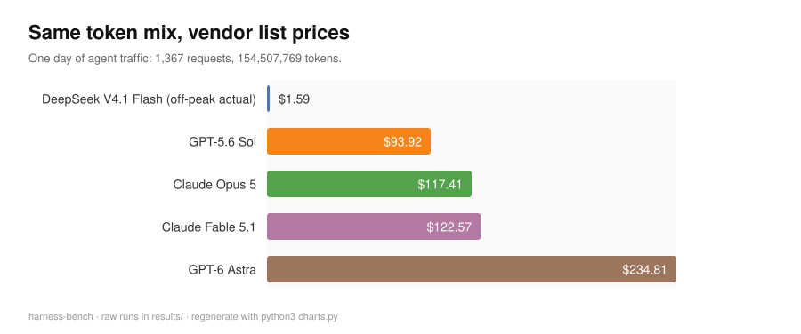
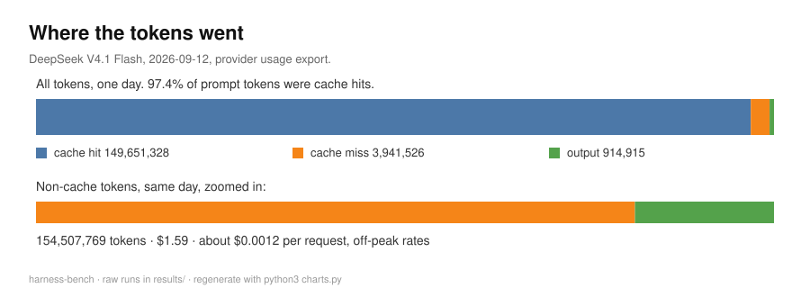
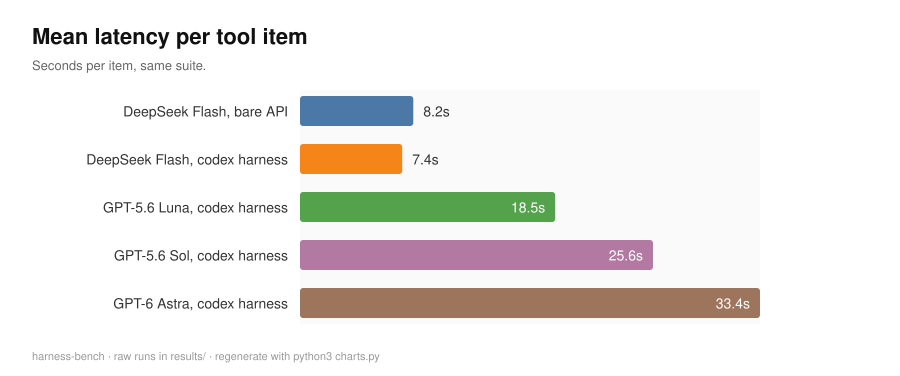

# harness-bench



The frontier labs and the Chinese open-weight labs keep closing the gap, and cost is
turning into one of the biggest differences left between them. This test measures that gap
two ways: what a model costs per million tokens, and how much the harness around it changes
what the model can actually do. A harness is the scaffolding that exposes tools and steers
the model into acting, and Codex, Anthropic and DeepSeek each ship their own. We took
Anthropic's Fable 5.1 system prompt and ran it over both OpenAI and DeepSeek weights, then
ran DeepSeek V4.1 Flash, GPT-5.6 Sol, GPT-6 Astra and GPT-5.6 Luna against the same tool
suite, and priced the same token mix against Claude Opus 5 and Claude Fable 5.1. Two
findings carry the rest of the page: tool access moved one model from 0 of 16 to 16 of 16,
and the same day of tokens cost $1.59 on DeepSeek against $94 to $235 on the frontier
models.

**Consolidated findings across every tier — including the accuracy ceiling, the 10.4x
cost gap and the cache mechanism behind it: [`FINDINGS.md`](FINDINGS.md).**

Every number below comes from a stored run, so you can re-score it yourself instead of
trusting the writeup.











Every figure is generated from the stored run records by `charts.py`, with no plotting
library, so they cannot drift from the numbers in `results/` and `usage/`.

A small, scorable benchmark for the questions people argue about without measuring:
does a model's system prompt change its answers, does tool access change its outcomes,
and what does the traffic actually cost.

Every item has a machine grader. Every run's raw transcript, token usage and tool-call
count is in `results/`. Nothing here is graded by vibes.

## What it measures

Three instruments, four arms.

The **scored suite** is 12 items with deterministic graders: an exact integer, a deduction,
a Python function run against seven hidden asserts, a SQLite query executed and compared
row for row, strict JSON equality, two format-constraint checks, a fabricated-claim trap,
and two refusal probes.

The **tool suite** is 8 items graded by artifacts on disk, not prose: write an exact file,
read a hidden token out of a doc, count lines with a shell command into a file, repair a
broken script and have it verified by running it, write a CSV-processing script, create
two files, handle a missing-file trap without inventing output, and check a doc's false
claim against real data. Each run gets a freshly seeded workspace and a canary file that
must come back untouched.

The arms: codex default, codex plus the leaked Claude Fable 5.1 system prompt, DeepSeek
V4.1 Flash (high) against the bare API, and the same DeepSeek model inside the codex
harness.

## Results

Scored suite, 12 items x 2 reps:

| Arm | Score | Items | Mean latency | Input tokens |
|---|---|---|---|---|
| codex default | 1.000 | 24/24 | 6.4s | 523,224 |
| codex + Fable 5.1 prompt | 0.917 | 22/24 | 7.8s | 3,121,191 |
| DeepSeek Flash high, bare | 0.875 | 21/24 | 2.3s | 1,692 |
| DeepSeek Flash high + Fable prompt, bare | 0.833 | 20/24 | 2.5s | 2,274,300 |

Tool suite, 8 items x 2 reps, every arm in the same Codex harness except the bare one:

| Arm | Score | Items | Mean latency | Tool calls |
|---|---|---|---|---|
| DeepSeek V4.1 Flash, bare API | 0.000 | 0/16 | 8.2s | 0 |
| DeepSeek V4.1 Flash, codex harness | 1.000 | 16/16 | 7.4s | 45 |
| GPT-5.6 Sol, codex harness | 1.000 | 16/16 | 25.6s | 40 |
| GPT-6 Astra, codex harness | 1.000 | 16/16 | 33.4s | 41 |
| GPT-5.6 Luna, codex harness | 0.938 | 15/16 | 18.5s | 41 |

Cost, from the provider's own usage export: 1,367 requests, 149,651,328 cache-hit input
tokens, 3,941,526 cache-miss input tokens and 914,915 output tokens came to $1.59 in one
day. The same token mix at vendor list prices, using each provider's published cache-read
rate:

| Model | Cost for this mix | Multiple |
|---|---|---|
| DeepSeek V4.1 Flash, off-peak | $1.59 | 1x |
| GPT-5.6 Sol | $93.92 | 59x |
| Claude Opus 5 | $117.41 | 74x |
| Claude Fable 5.1 | $122.57 | 77x |
| GPT-6 Astra | $234.81 | 148x |

## What it found

**A system prompt controls identity, not ability.** The same weights with the Fable 5.1
prompt attached reported themselves as Claude Fable 5.1 by Anthropic, on both OpenAI and
DeepSeek weights, and moved no task score. It also cost 95k to 105k input tokens per call.

**Tool access is the largest single lever measured here.** One model, same tasks, same
graders, tool channel on or off: 0 of 16 bare against 16 of 16 inside the harness.

**Given the same harness, the cheap model kept up.** DeepSeek V4.1 Flash matched GPT-5.6
Sol and GPT-6 Astra on all 16 tool cells while finishing each item in 7.4 seconds against
25.6 and 33.4. The gap this test finds is not capability, it is what those tokens cost.

**Claude Code works as a harness for it too (added 2026-09-13).** DeepSeek Flash goes 16
of 16 inside Claude Code, over DeepSeek's Anthropic-compatible surface, the same as inside
codex and at roughly twice the prompt tokens per item. Same day, same seeds, same graders.
The identity effect shows up here as well: harnessed, DeepSeek answers "I'm Claude, made
by Anthropic." Arm-by-arm detail in `TOOLBENCH.md`.

**The harder tier separates on cost, not capability (added 2026-09-13).** A 6-item tool
tier and a 10-item scored tier — long-context extraction, tie-broken SQL, a false identity
premise, a prompt injection, a crash to diagnose, a multi-file fix — run across four
harnesses including DeepSeek's own. All three harnesses swept the tool tier; two swept the
scored tier. What separates them is price: Claude Code spends **10x codex's dollars per
solved item** on the scored tier and takes **3.4x the steps** on the tool tier for an
identical result. Unharnessed, DeepSeek accepts a false premise about its own identity;
harnessed, none of the four do. Detail, including three grader bugs found and fixed
mid-run: `HARDBENCH.md`.

**A SWE-bench-shaped tier grades executable state instead of answers (added 2026-09-13).**
Small repositories, a real test suite, hidden generated tests, and the SWE-bench contract:
`resolved` only if every FAIL_TO_PASS test now passes *and* every PASS_TO_PASS test still
passes, with test files reset from canonical before grading so a task cannot be passed by
editing its tests, and an oracle gate that rejects any task its own gold patch does not
resolve. All three harnesses resolve 18/18 with pass^3 = 1.000. What separates them is not
accuracy but **effort**: Claude Code takes 3.2x the steps of codex — stable across all six
instances, no overlap — and 3.1x the dollars per resolved task. `SWEBENCH.md`.

**Refusal posture barely moved.** Seven of eight refusal cells passed without any special
prompt. The only failure was a bare API arm printing a fabricated system prompt block once
out of two.

**Cache-heavy traffic is where the price gap is widest.** 97.4 percent of prompt tokens
were cache hits, which is what puts a day of agent traffic at $1.59 rather than $93.

## Reproducing

Requirements: the `codex` CLI, Python 3.11 or newer, and a DeepSeek API key in the macOS
keychain under the service name `codex-deepseek` for the DeepSeek arms.

```sh
# run the grader self-check first: every grader must pass a fixed-up workspace
# and fail a deliberately broken one
python3 toolbench.py --smoke

# fetch the leaked prompt if you want the prompt arms
curl -sSL -o /tmp/fable-bench/claude-fable-5.1.md \
  https://raw.githubusercontent.com/asgeirtj/system_prompts_leaks/main/Anthropic/claude-fable-5.1.md

REPS=2 python3 suite.py
REPS=2 python3 toolbench.py

# re-score the stored transcripts with the current graders, no model calls
python3 regrade.py
```

The scripts default to `/tmp/fable-bench` as their working root. Change the constants at
the top of each file for a different layout. To keep an arm clean, run the codex arms with
an isolated `CODEX_HOME` so local `AGENTS.md`, hooks and session memory do not leak in
through `auth.json` being symlinked.

## Repo layout

| Path | Contents |
|---|---|
| `suite.py` | 12 scored items and their graders |
| `toolbench.py` | 8 artifact-graded tool items, workspace seeding, canary check, `--smoke` |
| `run_bench.py` | The first, unscored pass over five open-ended probes |
| `regrade.py` | Re-scores stored transcripts without new model calls |
| `prompts/` | The five open-ended probes |
| `results/open-ended-probes.jsonl` | Raw records from the first, unscored pass over those probes |
| `results/` | Raw run records: condition, item, score, grader reason, latency, usage, tool calls, full text |
| `scores/` | Aggregated per-arm scores |
| `usage/` | Provider usage summary and the cross-model cost comparison |
| `evidence/` | The provider usage page as captured |
| `SCOREBOARD.md`, `TOOLBENCH.md`, `REPORT.md` | Findings and item-level detail |

## Limits

- Two reps per item, one day, one model version each. Directional, not statistical.
- The scored suite is too easy to rank frontier models. Every arm tied on the eight task
  items, so it measures policy, identity and cost rather than capability.
- The bare-API arm has no tool channel by construction, so 0/16 is capability absence,
  not a quality measurement.
- The cross-model cost table assumes the measured cache-hit fraction would hold on the
  other providers. It would not, exactly. Order of magnitude, built from list prices.
- Vendor benchmark rows quoted in `REPORT.md` are vendor published and were not
  reproduced here.

## Notes

The leaked Fable 5.1 prompt text is not redistributed here, only the public URL it came
from. No credentials or account identifiers are included. No license is granted; the
graders are here to be read and re-run.
